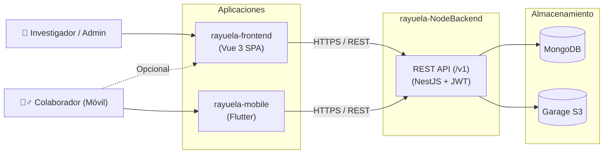

# Plataforma Rayuela

Esta plataforma propone un abordaje para incorporar ludificación adaptativa a proyectos de ciencia ciudadana. Provee herramientas integradas para la gestión científica, configuración de estrategias de gamificación y administración de proyectos.

> **Alcance y Audiencia de la Aplicación:**
> `rayuela-frontend` está destinado y diseñado específicamente para perfiles de **Administradores e Investigadores** (gestión y configuración de proyectos, definición de tareas con georrestricciones, diseño de estrategias de ludificación adaptativa y monitoreo de métricas/desvanecimiento de medallas).
> Los **Colaboradores y Voluntarios** realizan las tareas de campo y recolección de datos a través de la aplicación móvil oficial ([`rayuela-mobile`](https://github.com/Rayuela-v2/rayuela-mobile)). Si bien los colaboradores técnicamente pueden iniciar sesión y acceder a la interfaz web, la experiencia principal de participación comunitaria se encuentra delegada en la app móvil.

## Tecnologías - Versiones

### Base de datos

- **MongoDB** (Base de datos documental NoSQL con Mongoose)
- **Garage S3** (Almacenamiento de objetos compatible con S3 para imágenes y recursos multimedia)

### Backend/Backoffice

- **NestJS** con **TypeScript** (`rayuela-NodeBackend`)
- Arquitectura modular desacoplada con motor de ludificación adaptativa basado en el patrón Strategy (puntos, medallas y ciclo de desvanecimiento de medallas / *badge fading*).

### API

- **REST API** con prefijo `/v1`
- Autenticación centralizada mediante **JWT (JSON Web Tokens)** con guardias de roles (`RolesGuard`) y soporte para **Google OAuth 2.0 (Google Identity)**
- Documentación interactiva de la API con **Swagger / OpenAPI** en `/docs`

### Frontend Web

- **Vue.js 3** (*v3.3.4*) con **Vite** (*v4.4.9*)
- **Vuetify 3** (*v3.7.0*) y fuentes Material Design Icons (`@mdi/font`)
- Manejo de estado centralizado con **Vuex 4** (*v4.0.2*)
- Mapas interactivos con **OpenLayers** (`ol` *v10.1.0*) y capas de OpenStreetMap (OSM)
- Gráficos y analíticas con **Chart.js** y **vue-chartjs**
- Internacionalización reactiva con **vue-i18n** (*v9.3.0*)
- **Node.js (LTS)** *v18.17.1* y **npm**

### Arquitectura de la Plataforma

En la arquitectura actual (**Rayuela v2**), `rayuela-frontend` funciona como la Single Page Application (SPA) para investigadores y administradores, comunicándose mediante la API REST con `rayuela-NodeBackend` y la capa de persistencia:



## Pre-requisitos

* Se recomienda tener instalado [nvm](https://github.com/nvm-sh/nvm) para manejar diferentes versiones de Node.js.
* Es necesario tener instalado y en funcionamiento el backend de la plataforma ([rayuela-NodeBackend](https://github.com/Rayuela-v2/rayuela-NodeBackend)), junto con sus servicios de infraestructura (MongoDB y Garage S3).

## Instalación del entorno

#### Instalación de node

Versión Node (LTS): **v18.17.1**
```bash
nvm install 18.17.1
```
> **Nota:** La versión se encuentra fijada en el archivo `.nvmrc`.

#### Instalación del proyecto

Clonamos el repositorio oficial:
```bash
git clone https://github.com/Rayuela-v2/rayuela-frontend.git
```

Ingresamos a la carpeta del proyecto:
```bash
cd rayuela-frontend
```

Cambiamos a la versión de Node definida en `.nvmrc`:
```bash
nvm use
```

Instalamos los paquetes y dependencias npm:
```bash
npm install
```

#### Variables de entorno

1. Copiar el archivo `env.example` y nombrarlo **.env** (o **.env.production** para entornos de producción):
   ```bash
   cp env.example .env
   ```
2. Completar las variables dentro del archivo con los datos del entorno:
   - `VITE_ROOT_API`: URL base del backend REST (ejemplo local: `http://localhost:3000/v1`).
   - `VITE_GOOGLE_CLIENT_ID`: *(Opcional)* Client ID Web generado en Google Cloud Console para habilitar inicio de sesión y registro mediante Google Identity.
3. Para hacer uso de estas variables de configuración en el código de la aplicación, utilizar `import.meta.env.<CLAVE>`. Por ejemplo:
   ```javascript
   import.meta.env.VITE_ROOT_API
   ```

## Despliegue de la aplicación

#### Servidor de desarrollo
Inicia el servidor local de desarrollo con Hot Module Replacement (HMR):
```bash
npm run dev
```
Comprobamos su funcionamiento en la URL devuelta por la consola (por defecto: `http://localhost:5173/`).

#### Compilación para producción
Genera el paquete optimizado de la SPA en el directorio `dist/`:
```bash
npm run build
```

#### Previsualización local del bundle de producción
Permite levantar un servidor local para probar los archivos construidos en `dist/`:
```bash
npm run preview
```

## Internacionalización

La plataforma utiliza **vue-i18n** con archivos JSON en el directorio `src/locales/`:
- `es.json` (Español - idioma primario)
- `en.json` (Inglés)
- `pt.json` (Portugués)

El formato estándar es clave-valor:
```json
{
    "home": "Inicio",
    "about": "Acerca de"
}
```

También se agrupan por módulos, vistas o componentes:
```json
{
    "grupo": {
        "var_1": "Traducción var_1",
        "var_2": "Traducción var_2"
    }
}
```

> **Regla de Desarrollo:** Cada vez que se incorpore o modifique un texto visible de cara al usuario en la interfaz, deben mantenerse sincronizadas las traducciones correspondientes en **todos** los archivos de idioma (`es.json`, `en.json` y `pt.json`).

## Ejecución de los tests

#### Tests unitarios y de componentes (Vitest)
Ejecuta las pruebas unitarias y de componentes escritas con Vitest y `@vue/test-utils`:
```bash
npm run test:unit
```
Para ejecutar en modo de una sola pasada sin observador:
```bash
npm run test:unit -- --run
```

#### Tests End-to-End (Playwright)
Ejecuta las pruebas de extremo a extremo automatizadas:
```bash
npm run test:e2e
```
Para abrir la interfaz gráfica interactiva de Playwright:
```bash
npm run test:e2e:dev
```

#### Verificación de código y linter (ESLint)
Ejecuta el análisis estático y corrección automática de estilo:
```bash
npm run lint
```

## Créditos

* **Sergio** - [tarbz2](https://github.com/tarbz2).
* **Equipo de Desarrollo Rayuela v2**.

## License

Rayuela is a free software and content project:

- The source code is licensed under the **GNU General Public License v3.0 or later (GPLv3+)**. See the [LICENSE](LICENSE) file for details.
- The site content is licensed under the **Creative Commons Attribution-NonCommercial-ShareAlike 4.0 International (CC BY-NC-SA 4.0)**. See the [CONTENT-LICENSE.md](CONTENT-LICENSE.md) file for details.
